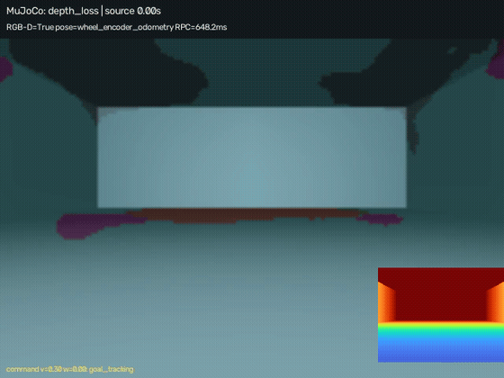

# Indoor perception and robot ML reliability

Two independently installable Python projects, with a shared inference SDK, by **Ahmet Numan Şahin**. Independent, AI-assisted research portfolio; no affiliation with ROZOR.

**Start here:** [Perception project](projects/indoor-perception-lab.md) · [Reliability project](projects/robot-reliability-bench.md) · [Watch the 78 s demo](https://numann44.github.io/indoor-perception-robot-reliability/) · [Demo provenance](demo/README.md) · [Measured results](docs/RESULTS.md) · [Run a fixture](docs/REPRODUCIBILITY.md)

## What the projects do

| Project | Scope | Main source |
|---|---|---|
| Indoor Perception Lab | RGB-D geometry, person detection, semantic segmentation, causal tracking, motion prediction and pose-assisted mapping | [Python package](packages/indoor_perception_lab) |
| Robot ML Deployment & Reliability Bench | Independent model adapters, bounded replay queues, timing, corruptions, ROS2 and MuJoCo feedback-loop experiments | [Python package](packages/robot_reliability_bench) |
| Shared model SDK | Versioned sensor/result/control contracts and backend adapters | [SDK](packages/robot_model_sdk) |

## Locked primary results

| Evaluation | Primary result | Comparator / limitation |
|---|---|---|
| NYU Depth V2 segmentation, 654 official test images | **0.27309 mIoU** | V1 0.05163 on the same test |
| Fresh JAAD detection, 480 frames | **0.14814 AP** | COCO initialization 0.05545; V1 0.06737 |
| External MOT17-11 detection, 900 frames | **0.49139 AP50** | COCO 0.50179 is higher |
| MOT tracking, same detector | **0.32303 IDF1; 264 switches** | Fails target 0.40 and switch nonregression: legacy 238 |
| JAAD 2 s forecasting | **ADE 0.04783 / FDE 0.10301** | Normalized image units; 276/755 eligible histories (36.56%) |
| Matched robot simulation | **57/60 geometric; 59/60 active; zero contacts** | Exposed seed bank; primary occlusion 7/10 fails |

Primary seed 42 and model selection were fixed before test admission. Seeds 43/44 are descriptive repeats. Aggregate values are transcribed from retained measured files; [public evidence and source hashes](evidence/README.md). No new training or test-based tuning was performed for this publication.

## Engineering evidence

- Fresh original-workspace verification: 212 main tests, 6 subtests and 32 robotics tests passed. These are historical scopes, not a claim that the entire corpus-dependent suite runs from this source-only export.
- Three independent 0.2.0 package environments; CPU and qualified MPS execution with silent fallback disabled.
- Actual ROS2 DDS sensor → queued selected-model inference → result/control consumer → MuJoCo actuation. Real OpenLORIS recordings were also processed locally.
- 22 Mac timing profiles, three fresh processes per profile, 10 warmups and 100 distinct validation inputs per process; 95 corruption-accuracy rows.
- Strict FP32 export parity and INT8 acceptance **failed**. Native remains the default. CPU intra-op profiles are Mac measurements, not embedded-device measurements.

## Scope and honest limits

Overall outcome remains **PARTIAL**. This is research software with failed quality gates, not a production robot or safety certification. Physical robot operation and embedded power/thermal measurements were not performed. Recorded wheel-odometry-assisted mapping is not SLAM. The public demo uses only original controlled simulation panels; research dataset pixels, annotations, weights and private runtime logs are excluded.

[Reproduction and acquisition boundaries](docs/REPRODUCIBILITY.md) · [Data and licensing](docs/DATA_AND_LICENSES.md) · [AI assistance and contributions](docs/CONTRIBUTIONS.md) · [Source notice](NOTICE.md)
