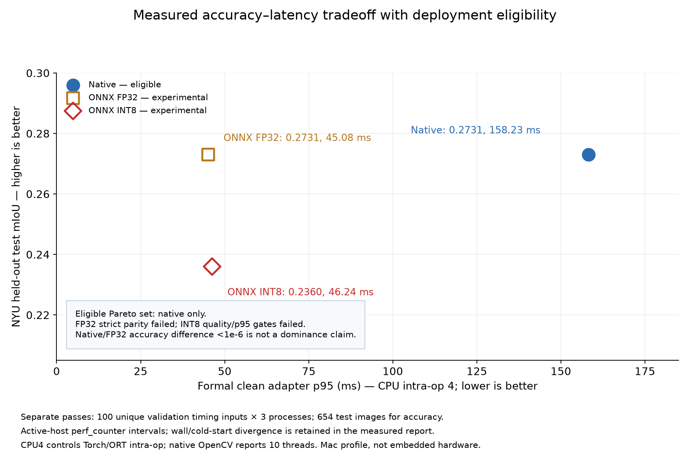
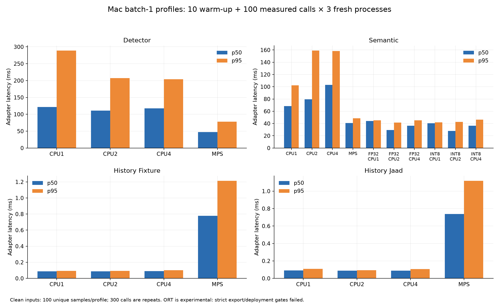
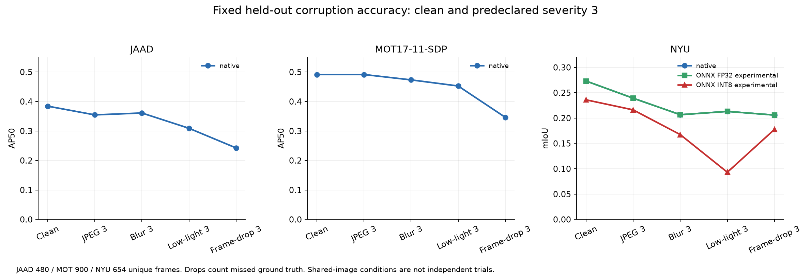

# Measured results and limitations

These are retained quality-v2 results measured on one Apple M4 Mac, not new measurements made during publication. Fixed primary seed 42; candidate selection used validation, not test-winning seeds.

| Scope | Result / comparator |
|---|---|
| NYU test mIoU | 0.2730929 / V1 0.0516288; 654 images |
| JAAD test AP | 0.1481366 / COCO 0.0554547 / V1 0.0673665; 480 frames |
| MOT17-11 AP50 | 0.4913868 / COCO 0.501789; 900 frames |
| MOT IDF1; ID switches | 0.3230336 vs 0.2904739; 264 vs 238; quality fails |
| JAAD 2 s ADE; FDE | 0.0478281; 0.1030068 vs LS-CV 0.0580720; 0.1223987 |
| JAAD forecast coverage | 276/755 eligible histories, 36.56%; normalized image coordinates |
| Fixture 2 s ADE; FDE | 0.029686 m; 0.065454 m vs LS-CV 0.089893 m; 0.206675 m; 1,248/1,248 windows |
| Primary geometric simulation | 57/60 goals; five scenarios 10/10, occlusion 7/10; zero 5 ms contacts |
| Secondary active simulation | 59/60; occlusion 9/10; only 3 person-hazard vs 130 stale command changes; delays differ |

## Deployment is a measured failed acceptance

D3 original-JAAD-input MPS adapter p50/p95: 47.56/77.94 ms; CPU intra-op 4: 117.90/204.24 ms. These are not live robot latencies.

S3 CPU intra-op 4 adapter p95: native 158.231 ms; ONNX FP32 45.081 ms; INT8 46.240 ms. INT8 is faster than native but 2.57% slower than the predeclared FP32 comparator. INT8 validation mIoU loss is 0.030311, exceeding 0.01. Strict FP32 allclose passes 0/142 at rtol 1e-4/atol 1e-5 despite high argmax agreement. **Native stays default.**

22 timing profiles use 10 warmups and 100 distinct validation samples in each of three fresh processes. Accuracy has 95 rows over 19 conditions and five profiles, using held-out samples. Mac thread labels are intra-op settings, not total-process core caps; OpenCV reports 10. Model active-host timing and UTC diverge; the cause is unproven and a raw cold-start outlier remains. No embedded power/thermal, physical safety or production guarantees follow.

## What the public evidence contains

[Machine-readable quality summary](../evidence/quality-summary.json), [deployment decision](../evidence/deployment-decision.json), [verification excerpt](../evidence/software-verification.json), and [publication provenance](../evidence/publication-provenance.json). Original unredacted logs, source archives, checkpoints and model outputs remain in the local research workspace. The export does not include those full artifacts or dataset pixels. No private local-only link is presented as a public proof.

## Measured figures

